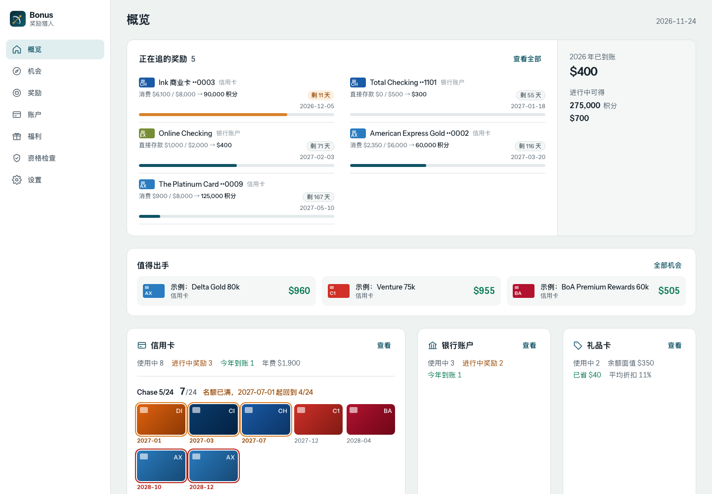
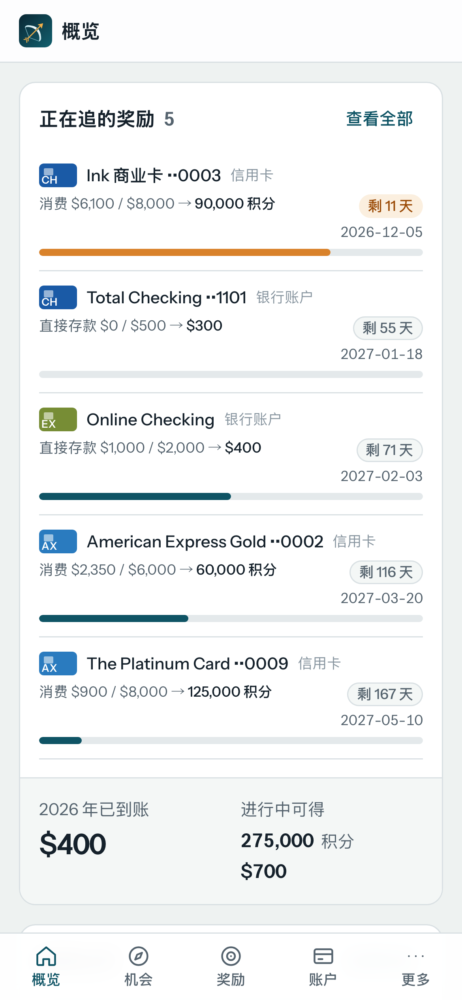

# bonus

Personal bonus hunter on Cloudflare: credit card sign-up bonuses, bank account opening bonuses,
gift card discounts and other rewards, all on one generic model. The UI is organised around the hunt
(every bonus in progress, whatever the category) with a panel per category. Phase 1 rules engine: credit cards — accounts, timeline,
sign-up bonus progress, recurring benefits, and an issuer-rules eligibility checker
(Chase 5/24, Sapphire, Amex lifetime/family/limit, Citi 48-month & 1/8 & 2/65, BoA 2/3/4,
Barclays 6/24). Web UI in Simplified Chinese, works on wide screens and phones (installable PWA),
plus a remote MCP server for Claude. The data model is generic so bank-account bonuses and
gift cards can be added later. The icon is a drawn hunting bow with a rune-fletched gold arrow,
a nod to Skaði, the Norse goddess of the hunt.

| Wide | Phone |
| --- | --- |
|  |  |

*(Screenshots use fictional demo data from `examples/demo-history.json`.)*

## Architecture

One Cloudflare Worker at `bonus.timothyxlu.xyz`:

```
                    ┌──────────── Cloudflare Access (GitHub login) ────────────┐
browser ──────────► │  /*  static SPA (Workers Static Assets)                    │
                    │  /api/*  Hono REST API ── verifies Cf-Access-Jwt-Assertion │
                    │  /authorize  MCP consent page ── same JWT check, then      │
                    │              issues OAuth code bound to the Access email   │
                    └───────────────────────────────────────────────────────────┘
Claude ──(bypass)─► /mcp  Streamable HTTP MCP ── OAuth 2.1 (workers-oauth-provider)
                    /token /register /.well-known/*
                                   │
            services (apps/worker/src/services) ── D1 (Drizzle) · KV (OAuth state)
                                   │
            @bonus/core rules engine (pure TS, shared by API, MCP and UI)
```

```
apps/worker     Worker: Hono API, MCP server, OAuth handler, Drizzle schema + migrations
apps/web        React + Vite + Tailwind SPA (zh-CN strings in src/i18n.ts)
packages/core   Domain types, catalog, date/benefit-period helpers, eligibility engine
docs/           SETUP.md (owner's manual steps), IMPORT.md (import format)
```

Notes:

- **MCP** uses the agents SDK's stateless `createMcpHandler` (`agents/mcp/server`) with the MCP SDK v2
  `McpServer`, following Cloudflare's current `remote-mcp-cf-access` demo. `McpAgent` is deprecated
  in `agents@0.34` and would need a Durable Object for nothing. Tools: `list_accounts`, `get_account`,
  `add_account`, `record_event`, `list_benefits`, `mark_benefit_used`, `upcoming_deadlines`,
  `check_eligibility`, `five_24_status`, plus `list_products`, `list_bonuses`, the opportunity tools
  `list_opportunities` / `add_offer` / `update_offer` (Claude can research current offers and record them),
  benefit editing `add_benefit` / `update_benefit` / `delete_benefit`,
  bonus editing `add_bonus` / `update_bonus` / `delete_bonus` (including multi-step bonuses),
  catalog editing `list_institutions` / `add_institution` / `update_institution` / `add_product` /
  `update_product` / `archive_product`, and account editing `update_account` / `delete_account`.
- **Editable catalog (产品库)**: seeded products and institutions are shared defaults. Editing one stores a
  per-owner override (merged on read; resyncs never clobber it, "恢复默认" drops it). Your own products are
  edited in place. Products are archived, never deleted. The shipped catalog re-syncs automatically when
  `CATALOG_VERSION` changes.
- **Multi-step bonuses**: one bonus can carry an ordered list of conditions (`steps`), e.g. a bank bonus that needs
  "deposit $15k of new money within 30 days" and then "keep $15k through day 90". Each step is done, holding (balance
  is there, hold date not reached), pending or overdue; the bonus shows overall progress and the next date that matters,
  and moves to met once every step is met.
  Offers on the 机会 page take the same steps in days from opening (`withinDays`, `holdDays`); "我已开户" turns them
  into a dated multi-step bonus, and the largest step amount is used for return on deposit.
- **机会 (opportunities)**: offers you might open next, valued in USD (points at per-programme
  cents, overridable), net of first-year fee and costs, ranked, and checked against your history:
  the issuer rules engine for cards, a same-institution cooldown for bank and gift-card offers.
- **Auth**: `/api` verifies the Access JWT in the Worker (signature/issuer/audience/expiry) and scopes
  every query by the user's email (`owner_id`). MCP tokens carry the same email, so web and MCP see the
  same data: `/authorize` sits behind Access, verifies the Access JWT and only asks for consent
  (no upstream IdP). Optional `ALLOWED_EMAILS` allowlist on top of Access policies.
- **Privacy**: account rows hold only the trailing 4 or 5 digits (Amex shows 5), validated in the API and by a DB `CHECK`.
- **Card secrets (web only)**: full card number / expiry / CVV and gift-card number / PIN can be saved per account.
  They are encrypted in D1 with AES-256-GCM (WebCrypto, random 96-bit IV per value, AAD binding owner + account + kind,
  key id stored for rotation) using the `CARD_ENCRYPTION_KEY` Worker secret, in a separate `account_secrets` table that
  no normal query joins. They are never returned by MCP, list endpoints or import/export, and never logged. Reveal is a
  POST that needs an Access login from the last 15 minutes, is rate-limited (10 per 10 min) and audited (no values),
  and the UI re-masks after 30 s. All `/api` responses are `Cache-Control: no-store` and the service worker never
  caches `/api`. Storing CVVs is your own decision; see docs/SETUP.md for the key and rotation.
  The repo contains only a generic product catalog; real history is imported through the app.

## Development

```sh
pnpm install
cp apps/worker/.dev.vars.example apps/worker/.dev.vars   # local identity = DEV_USER_EMAIL (localhost only)
pnpm db:migrate:local
pnpm dev                    # wrangler dev on :8787 + vite on :5173 (proxies /api)
# optional fictional data:
curl -X POST localhost:8787/api/import -H 'content-type: application/json' --data-binary @examples/demo-history.json
```

```sh
pnpm typecheck
pnpm build                  # builds the SPA into apps/web/dist (served by the Worker)
pnpm test                   # core rules (vitest), worker API/MCP/auth (vitest-pool-workers), web i18n
```

Schema changes: edit `apps/worker/src/db/schema.ts`, then `pnpm --filter @bonus/worker db:generate`.

## Deploy

GitHub Actions: `CI` runs typecheck/build/tests on PRs; `Deploy` on `main` also creates/looks up the D1
database and KV namespace, applies migrations and runs `wrangler deploy`. One-time dashboard steps
(API token, Access apps, GitHub login, secrets, connecting Claude) are in **[docs/SETUP.md](docs/SETUP.md)**.
