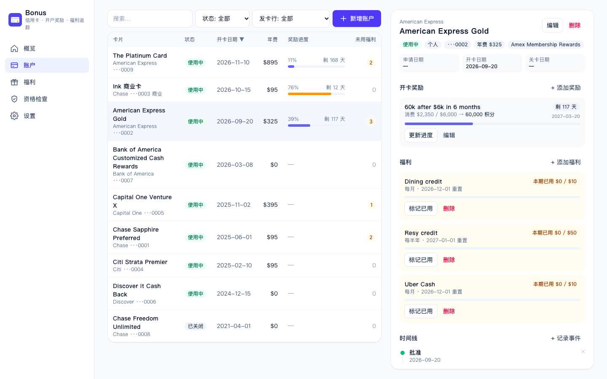

# bonus

Personal rewards / bonus tracker on Cloudflare. Phase 1: credit cards — accounts, timeline,
sign-up bonus progress, recurring benefits, and an issuer-rules eligibility checker
(Chase 5/24, Sapphire, Amex lifetime/family/limit, Citi 48-month & 1/8 & 2/65, BoA 2/3/4,
Barclays 6/24). Web UI in Simplified Chinese, works on wide screens and phones (installable PWA),
plus a remote MCP server for Claude. The data model is generic so bank-account bonuses and
gift cards can be added later.

| Wide | Phone |
| --- | --- |
|  |  |

*(Screenshots use fictional demo data from `examples/demo-history.json`.)*

## Architecture

One Cloudflare Worker at `bonus.timothyxlu.xyz`:

```
                    ┌──────────── Cloudflare Access (GitHub login) ────────────┐
browser ──────────► │  /*  static SPA (Workers Static Assets)                    │
                    │  /api/*  Hono REST API ── verifies Cf-Access-Jwt-Assertion │
                    └───────────────────────────────────────────────────────────┘
Claude ──(bypass)─► /mcp  Streamable HTTP MCP ── OAuth 2.1 (workers-oauth-provider)
                    /authorize /callback /token /register /.well-known/*
                          └── upstream login: Access for SaaS (OIDC) → GitHub
                                   │
            services (apps/worker/src/services) ── D1 (Drizzle) · KV (OAuth state)
                                   │
            @bonus/core rules engine (pure TS, shared by API, MCP and UI)
```

```
apps/worker     Worker: Hono API, MCP server, OAuth handler, Drizzle schema + migrations
apps/web        React + Vite + Tailwind SPA (zh-CN strings in src/i18n.ts)
packages/core   Domain types, catalog, date/benefit-period helpers, eligibility engine
docs/           SETUP.md (owner's manual steps), IMPORT.md (import format)
```

Notes:

- **MCP** uses the agents SDK's stateless `createMcpHandler` (`agents/mcp/server`) with the MCP SDK v2
  `McpServer`, following Cloudflare's current `remote-mcp-cf-access` demo. `McpAgent` is deprecated
  in `agents@0.34` and would need a Durable Object for nothing. Tools: `list_accounts`, `get_account`,
  `add_account`, `record_event`, `list_benefits`, `mark_benefit_used`, `upcoming_deadlines`,
  `check_eligibility`, `five_24_status` (+ `list_products` to discover product ids).
- **Auth**: `/api` verifies the Access JWT in the Worker (signature/issuer/audience/expiry) and scopes
  every query by the user's email (`owner_id`). MCP tokens carry the same email, so web and MCP see the
  same data. Optional `ALLOWED_EMAILS` allowlist on top of Access policies.
- **Privacy**: only the last 4 digits are accepted (validated in the API and by a DB `CHECK`).
  The repo contains only a generic product catalog; real history is imported through the app.

## Development

```sh
pnpm install
cp apps/worker/.dev.vars.example apps/worker/.dev.vars   # local identity = DEV_USER_EMAIL (localhost only)
pnpm db:migrate:local
pnpm dev                    # wrangler dev on :8787 + vite on :5173 (proxies /api)
# optional fictional data:
curl -X POST localhost:8787/api/import -H 'content-type: application/json' --data-binary @examples/demo-history.json
```

```sh
pnpm typecheck
pnpm build                  # builds the SPA into apps/web/dist (served by the Worker)
pnpm test                   # core rules (vitest), worker API/MCP/auth (vitest-pool-workers), web i18n
```

Schema changes: edit `apps/worker/src/db/schema.ts`, then `pnpm --filter @bonus/worker db:generate`.

## Deploy

GitHub Actions: `CI` runs typecheck/build/tests on PRs; `Deploy` on `main` also creates/looks up the D1
database and KV namespace, applies migrations and runs `wrangler deploy`. One-time dashboard steps
(API token, Access apps, GitHub login, secrets, connecting Claude) are in **[docs/SETUP.md](docs/SETUP.md)**.
